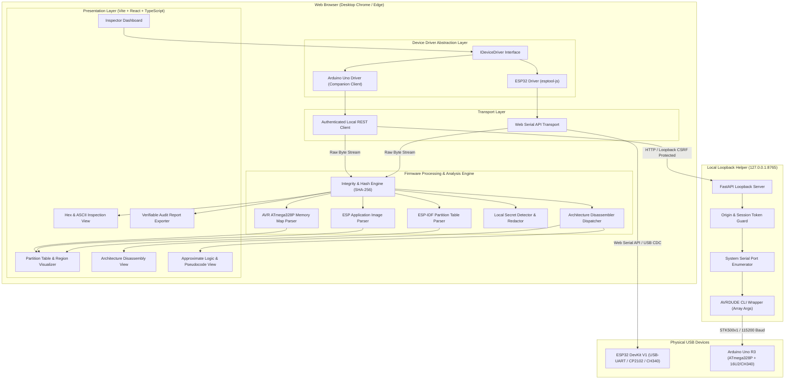

# Architecture Specification: MICROCODE INSPECTOR

## 1. System Overview

MICROCODE INSPECTOR is structured as a browser-first, modular embedded reverse-engineering platform. It is engineered with a strict separation of concerns across communication transports, device drivers, binary analysis engines, disassembly modules, and presentation layers.



---

## 2. Core Architectural Layers

### Layer 1: Hardware Transport Layer
Abstracts physical byte transport across differing platform APIs:
- **`WebSerialTransport`**: Communicates directly with USB-to-UART bridges (CP210x, FTDI, CH340) or native USB-Serial/JTAG via the W3C Web Serial API (`navigator.serial`).
- **`CompanionHttpTransport`**: Interfaces with the local loopback agent for microcontrollers requiring external host utilities (e.g., AVRDUDE for Arduino Uno).

### Layer 2: Device Driver Interface (`IDeviceDriver`)
All microcontrollers implement a uniform lifecycle interface:
```typescript
export interface DeviceIdentity {
  family: 'ESP32' | 'AVR_ATMEGA';
  model: string;                // e.g., "ESP32 (revision v3.0)", "ATmega328P"
  architecture: 'xtensa-lx6' | 'xtensa-lx7' | 'riscv32' | 'avr8' | 'unknown';
  detectedFlashBytes: number | null;
  securityFeatures: {
    flashEncryption: 'disabled' | 'enabled' | 'unknown';
    secureBoot: 'disabled' | 'enabled' | 'unknown';
    lockBitsHex?: string;
  };
}

export interface MemoryRegion {
  name: string;
  startAddress: number;
  sizeBytes: number;
  type: 'bootloader' | 'partition_table' | 'app' | 'data' | 'nvs' | 'eeprom' | 'padding' | 'unknown';
  isReadable: boolean;
}

export interface IDeviceDriver {
  connect(portHint?: any): Promise<DeviceIdentity>;
  detectCapacity(): Promise<number>;
  getMemoryMap(): Promise<MemoryRegion[]>;
  readRegion(startAddress: number, sizeBytes: number, onProgress?: (bytesRead: number, total: number) => void): Promise<Uint8Array>;
  resetToNormalBoot(): Promise<void>;
  disconnect(): Promise<void>;
}
```

### Layer 3: Integrity & Memory Extraction Engine
- **Chunked Safe Streaming**: Memory reads are divided into verified chunks (typically 4 KiB - 64 KiB) with continuous progress reporting and address verification.
- **Immediate SHA-256 Hashing**: A cryptographic digest is computed immediately over captured memory blocks using Web Crypto API (`crypto.subtle.digest("SHA-256", ...)`).
- **Format Encoders**: Converts raw bytes into Intel HEX (`.hex`) and raw binary (`.bin`) with round-trip checksum validation.

### Layer 4: Binary & Partition Parsing Engine
- **ESP-IDF Partition Table Parser**:
  - Locates partition table at offset `0x8000` (or legacy/custom `0x9000`).
  - Validates partition entry magic bytes (`0xAA 0x50`).
  - Extracts partition type (App `0x00`, Data `0x01`), subtype (factory, ota_0..15, nvs, spiffs, fat), label, offset, length, and encryption flags.
- **ESP Application Image Header Parser**:
  - Parses the 24-byte ESP image header:
    - Magic byte: `0xE9`
    - Segment count (1..16)
    - SPI mode (QIO, QOUT, DIO, DOUT)
    - SPI speed (40MHz, 80MHz, etc.)
    - SPI size (1MB, 2MB, 4MB, 8MB, 16MB)
    - Entry point address (e.g. `0x40080698` in IRAM)
  - Iterates segments: load address, data length, payload bytes.
  - Checks for trailing SHA-256 hash append (ESP32-S2/S3/C3 and newer ESP-IDF v3.0+ builds).
- **AVR Memory Map Parser**:
  - Standard ATmega328P Flash layout (32 KiB / 32,768 bytes).
  - Reset vector (`0x0000`) and 25 interrupt vectors (`0x0002` through `0x0032`).
  - Delineates application space (`0x0000` to `0x7DFF` or `0x7FFF`) from Optiboot bootloader space (`0x7E00` to `0x7FFF`, 512 bytes).
  - Explicitly detects and tags unprogrammed Flash blocks (`0xFF` sequences).

### Layer 5: Architecture-Specific Disassembly Engine
- **Xtensa LX6 Disassembler**: Decodes 24-bit standard and 16-bit narrow instructions for ESP32. Resolves program counter relative calls (`CALL0`, `CALL4`, `CALL8`, `CALL12`), literal load pools (`L32R`), branch targets, and known ESP-IDF ROM vector addresses.
- **AVR 8-bit Disassembler**: Decodes 16-bit and 32-bit AVR instructions (`RJMP`, `CALL`, `RCALL`, `LDI`, `IN`, `OUT`, `SBI`, `CBI`, `LDS`, `STS`). Maps I/O ports (`0x00` - `0x3F`) to ATmega328P hardware registers (`PORTB`, `DDRB`, `PINB`, `UDR0`, `UCSR0A`, `ADCSRA`, `ADMUX`, `TCCR1A`, etc.).
- **Boundary Enforcement**: Disassembly is only allowed when base load addresses and architecture are unequivocally known. Disassembly never modifies source bytes.

### Layer 6: Heuristic Pseudocode & Logic Explanation Engine
- Reconstructs higher-level control flow graphs (loops, conditional branches, switch tables).
- Identifies standard initialization patterns (UART setup, GPIO pin direction configuration, SPI/I2C transactions, timer interrupts).
- **Uncertainty Transparency**:
  - Marks inferred variables as hypotheses: `unknown_var_001`, `inferred_loop_counter`.
  - Flags confidence ratings: `HIGH (Direct register mapping)`, `MEDIUM (Structural control flow match)`, `LOW (Heuristic pattern match)`.
  - Displays prominent disclaimers that output is an approximate synthetic representation, not original source code.

### Layer 7: UI & User Experience
- Built with React 19, TypeScript, and modern CSS modules/Tailwind.
- High performance virtualized hex viewer supporting Multi-Megabyte images without browser DOM lag.
- Live progress indicator with address range reporting (`0x00001000 - 0x00002000`).
- Local redactor for secrets: scans for private keys, AWS/cloud tokens, Wi-Fi passwords, and certificates, redacting them before display in logs or reports unless explicitly toggled by user.

---

## 3. Local AVR Companion Agent Architecture

For hardware requiring native tooling (Arduino Uno with AVRDUDE):
- **Server**: FastAPI running exclusively on `http://127.0.0.1:8765`.
- **Security & Authorization**:
  - Validates `Origin` matches browser frontend (`http://localhost:5173`, `http://127.0.0.1:5173`).
  - Generates ephemeral local session token during companion launch; client must present token in header `X-MicroCode-Session`.
  - Only accepts ports verified against active hardware serial ports (`serial.tools.list_ports`).
  - Strict input sanitization rejecting shell metacharacters.
  - Subprocess executed exclusively with argument vectors:
    ```python
    subprocess.run(
        ["avrdude", "-p", "atmega328p", "-c", "arduino", "-P", validated_port, "-b", "115200", "-U", f"flash:r:{temp_hex}:i"],
        capture_output=True,
        text=True,
        timeout=60
    )
    ```
  - Strictly read-only operations (`-U flash:r:...` / `-U lock:r:...`). Never write or chip-erase.

---

## 4. Migration Rationale: Prototype v0.1.1 to Production Scaffold

The starter scaffold (`MicroCode_Inspector_v0.1.1`) verified basic Web Serial connection with vanilla JS and a single `agent/main.py`. However, production requirements necessitate migration to Vite + React + TypeScript:
1. **Type Safety**: Parsing binary headers, bitfields, partition records, and Xtensa/AVR instruction encodings in vanilla JavaScript is error-prone. TypeScript provides compile-time protection against offset and type errors.
2. **State Complexity**: Managing multi-stage connection states, progress callbacks, multi-region memory buffers, virtualized hex viewing, and disassembly panes requires declarative component state management.
3. **Automated Testing**: TypeScript enables unit testing of all parsers and drivers with Vitest and mocked serial streams without requiring physical hardware.
4. **Preservation**: The v0.1.1 prototype remains intact in `MicroCode_Inspector_v0.1.1/` as an audited reference, while the production codebase is structured cleanly in `src/` and `agent/`.
