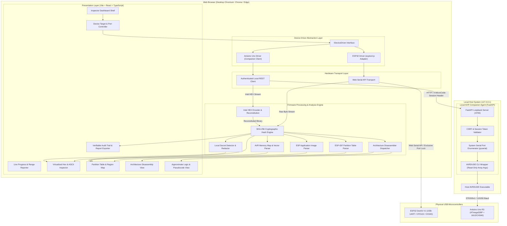
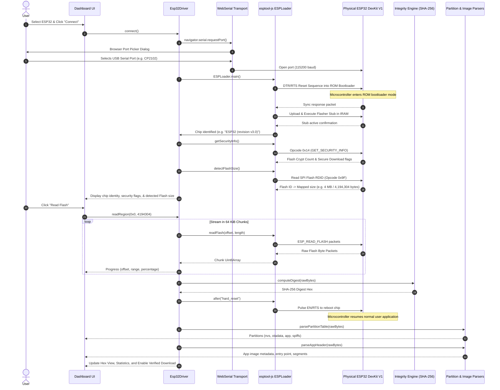

# Architecture Specification: MICROCODE INSPECTOR

## 1. System Overview & Component-Level Architecture

MICROCODE INSPECTOR is structured as a browser-first, modular embedded reverse-engineering platform. It is engineered with a strict separation of concerns across communication transports, device drivers, binary analysis engines, disassembly modules, and presentation layers.



---

## 2. Technology & Dependency Decision Record (ADR)

| Component | Selected Technology | Alternative Evaluated | Decision Rationale |
| :--- | :--- | :--- | :--- |
| **Frontend Framework** | **React 19 + TypeScript** | Vanilla JS / Svelte | Multi-region state, virtualized hex grids, multi-tab binary views, and strict typing of binary bitfields necessitate declarative components and compile-time type safety. |
| **Bundler & Build Tool**| **Vite 6** | Webpack / Parcel | Instant HMR, native ES modules, lightweight configuration, and direct compatibility with Web Serial and Web Workers. |
| **Test Runner** | **Vitest 3** | Jest / Mocha | Native Vite pipeline integration, blazing-fast execution, TypeScript support without Babel overhead, and node-compatible Web Crypto mocks. |
| **ESP32 Communication**| **esptool-js (0.7.1)** | Custom Web Serial ROM implementation | Official Espressif library containing validated ROM reset sequences, software stub flasher, chip magic detection, and SPI Flash ID decoding. |
| **AVR Extraction Method**| **Local Python Helper + AVRDUDE** | In-browser Web Serial STK500v1 | Optiboot DTR/RTS auto-reset timing over Web Serial in JavaScript is unreliable across varied host OS drivers. Native AVRDUDE provides battle-tested STK500v1 protocol implementation and precise DTR pulse handling. |
| **Companion Server** | **FastAPI + Uvicorn** | Node.js Express / Go binary | Python provides lightweight syntax, built-in subprocess management, `pyserial` hardware device enumeration, and clean type annotations via Pydantic. |
| **Integrity Hashing** | **Web Crypto API (`crypto.subtle`)** | CryptoJS / js-sha256 | Native hardware-accelerated SHA-256 implementation available in modern browsers without third-party bundle bloat. |
| **Styling & UI Shell** | **Scoped Modern CSS** | Tailwind CSS / Bootstrap | Zero dependency runtime footprint, high contrast dark theme optimized for technical binary inspection, and predictable rendering without external CDN lookups. |

---

## 3. Data-Flow Diagram: ESP32 Firmware Extraction

The ESP32 extraction pipeline operates entirely browser-side over the W3C Web Serial API:



---

## 4. Data-Flow Diagram: Arduino Uno (AVR) Extraction

The Arduino Uno pipeline leverages the hardened local loopback companion to drive AVRDUDE:

```mermaid
sequenceDiagram
    autonumber
    actor User
    participant UI as Dashboard UI
    participant UnoDriver as ArduinoUnoDriver
    participant Companion as Local Companion (127.0.0.1:8765)
    participant Avrdude as AVRDUDE CLI
    participant Uno as Physical Arduino Uno (ATmega328P)
    participant Reconstitution as Reconstitution & Integrity Engine

    User->>UI: Select Arduino Uno & Click "Query Ports"
    UI->>UnoDriver: getAvailablePorts()
    UnoDriver->>Companion: GET /ports (Header: X-MicroCode-Session)
    Companion-->>UnoDriver: Enumerated physical COM ports (e.g. ["COM5"])
    UnoDriver-->>UI: Populate Port Dropdown

    User->>UI: Select "COM5" & Click "Read Flash"
    UI->>UnoDriver: readFlash("COM5")
    UnoDriver->>Companion: POST /read/uno { port: "COM5", baud: 115200 }
    
    Note over Companion: Validate Origin & Session Token
    Note over Companion: Verify "COM5" exists in enumerated physical ports
    
    Companion->>Avrdude: subprocess.run(["avrdude", "-p", "atmega328p", "-c", "arduino", "-P", "COM5", "-b", "115200", "-U", "lock:r:...:h", "-U", "flash:r:...:i"])
    Avrdude->>Uno: Toggle DTR to enter Optiboot
    Note over Uno: Microcontroller enters Optiboot bootloader
    Avrdude->>Uno: STK_GET_SYNC & Signature query
    Uno-->>Avrdude: Signature 0x1E 0x95 0x0F (ATmega328P)
    Avrdude->>Uno: STK_READ_PAGE (Flash pages 0x0000 - 0x7FFF)
    Uno-->>Avrdude: Flash bytes (32 KiB)
    Avrdude-->>Companion: Intel HEX file + Lock bits
    
    Companion-->>UnoDriver: JSON { hexRecords: "...", lockBits: "0x3F", signature: "0x1E950F" }
    
    UnoDriver->>Reconstitution: parseAndReconstitute(hexRecords, 32768)
    Note over Reconstitution: Reconstruct 32 KiB buffer; tag unwritten trailing bytes as ERASED (0xFF)
    Reconstitution->>Reconstitution: Calculate SHA-256
    Reconstitution-->>UnoDriver: Verifiable 32 KiB Dump + SHA-256
    
    UnoDriver-->>UI: Display Memory Map (Vectors, App, Bootloader), Hex, and Verified Download
```

---

## 5. Architectural Security Boundaries

1. **Client Isolation**: The browser frontend runs strictly client-side. No remote cloud endpoints, analytics, or telemetry exist.
2. **Loopback Protection**: The Python companion binds exclusively to `127.0.0.1`. Requests require validation of the `Origin` header against `http://localhost:5173` and the presence of an ephemeral `X-MicroCode-Session` token generated at companion boot.
3. **Serial Argument Whitelisting**: Subprocess calls avoid `shell=True`. Ports are cross-referenced with `serial.tools.list_ports.comports()`, rejecting arbitrary device paths or injected characters.
4. **Strict Read-Only Enforcement**: Neither the TypeScript codebase nor the Python companion contains routines or command flags for flash writing (`:w:`), flash erasing (`eraseFlash`, `eraseRegion`), or chip erasure (`-e`).
