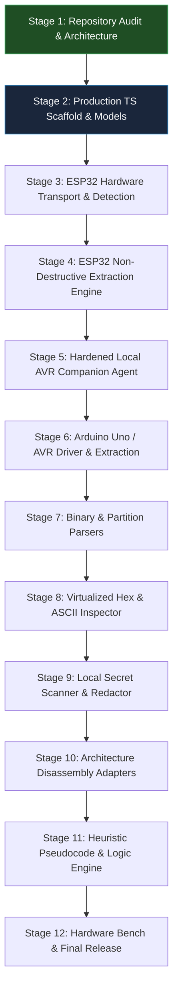

# Project Progress, 12-Stage Implementation Plan & Verification Matrix

## 1. 12-Stage Implementation Plan with Acceptance Gates

### Stage Breakdown & Strict Acceptance Gates

| Stage | Title & Scope | Status | Acceptance Gate Criteria |
| :---: | :--- | :---: | :--- |
| **Stage 1** | **Repository Audit, Official Docs Verification, & Architecture Specification** | **CURRENT (Active)** | - Full audit of existing `v0.1.1` starter code with all bugs and deficiencies documented. - Confirmation of official API contracts (`esptool-js`, Web Serial, Optiboot, AVRDUDE). - `AGENTS.md` and 5 specification documents established. - Zero hardware modification. |
| **Stage 2** | **Production TypeScript Scaffold, Domain Models & Test Runner** | Queued | - Vite 6 + React 19 + TypeScript configured at root with strict compiler checks. - Core domain models (`DeviceIdentity`, `MemoryRegion`, `ExtractionResult`) implemented. - Vitest test runner operational with static AST assertion tests proving zero write/erase APIs exist in codebase. - `npm run typecheck`, `npm run test`, and `npm run build` pass cleanly. |
| **Stage 3** | **ESP32 Transport & Chip Detection Driver** | Queued | - `Esp32Driver` implemented wrapping `esptool-js` 0.7.1 over Web Serial. - Runtime chip identification (model, revision, MAC, crystal frequency) without hardcoded assumptions. - SPI Flash capacity detected dynamically via `detectFlashSize()`. - Implementation of safe reset sequence returning microcontroller to normal boot after probing. |
| **Stage 4** | **ESP32 Non-Destructive Extraction Engine** | Queued | - Chunked flash streaming (64 KiB blocks) with continuous progress and address-range reporting. - Immediate SHA-256 calculation over captured bytes. - Detection of Flash Encryption / Secure Boot flags via `getSecurityInfo()`. - Non-destructive test slice read (first 256 KiB) validated with mocked serial stream. |
| **Stage 5** | **Hardened Local AVR Companion Agent** | Queued | - Python FastAPI server bound strictly to `127.0.0.1:8765`. - Origin validation and ephemeral `X-MicroCode-Session` token enforcement. - Port parameter cross-referenced against `serial.tools.list_ports.comports()`. - AVRDUDE invocation strictly using argument arrays with read-only flags (`-U flash:r:...`). Zero `shell=True`. - Pytest test suite covering token security, port validation, and error states. |
| **Stage 6** | **Arduino Uno / AVR Driver & Reconstitution Engine** | Queued | - Browser `ArduinoUnoDriver` connecting to local companion. - ATmega328P device signature verification (`0x1E 0x95 0x0F`) and lock-bit query. - Intel HEX reconstitution into 32 KiB memory buffer, tagging trailing unprogrammed space as `ERASED (0xFF)`. - Immediate SHA-256 computation over full 32 KiB image. |
| **Stage 7** | **Binary Parsers (ESP-IDF Partitions & App Headers)** | Queued | - Parser for ESP-IDF partition tables at `0x8000` / `0x9000` with magic `0xAA50`. - Parser for ESP application image headers (`0xE9`, segment counts, entry point in IRAM). - Parser for AVR interrupt vector table (`0x0000` - `0x0032`). - Unit tests covering valid, truncated, corrupted, and erased inputs. |
| **Stage 8** | **Virtualized Hex & ASCII Inspection Engine** | Queued | - Viewport-virtualized hex/ASCII table supporting multi-megabyte dumps without DOM lag. - Address offset navigation and printable ASCII/UTF-8 extraction. - Partition boundary highlighting. - Verified download controls for `.bin` and `.hex` formats with byte-count and checksum verification. |
| **Stage 9** | **Local Secret Scanner & Redactor** | Queued | - Client-side regex engine detecting Wi-Fi SSIDs/PSKs, cloud API keys, and private keys. - Automatic masking of probable secrets in UI previews and audit reports. - Explicit user confirmation toggle to reveal underlying raw bytes. |
| **Stage 10** | **Architecture Disassembly Adapters** | Queued | - Xtensa LX6 disassembler for classic ESP32 application segments. - AVR 8-bit disassembler for ATmega328P mapping hardware I/O ports (`PORTB`, `UDR0`, etc.). - Boundary validation: disassembly permitted only when base address and architecture are verified. |
| **Stage 11** | **Heuristic Pseudocode & Logic Explanation Engine** | Queued | - Control flow graph reconstruction (loops, conditional branches, switch tables). - Register and peripheral access idiom recognition (UART transmission, GPIO toggling). - Confidence grading (HIGH, MEDIUM, LOW) and prominent synthetic approximation warning banners. |
| **Stage 12** | **End-to-End Hardware Validation Bench & Final Release** | Queued | - Physical hardware test on user's ESP32 DevKit V1: extraction, SHA-256 verification, and proof of preserved sensor application. - Physical hardware test on Arduino Uno R3: signature verification, flash dump, and sketch preservation. - Final audit report generated; all documentation updated with authentic hardware test logs. |

---

## 2. Technical Claims Verification Matrix

This matrix classifies all operational and technical claims into four rigorous categories: **Confirmed**, **Uncertain / Dependent**, **Unsupported / Prohibited**, or **Requires Physical Hardware Validation**.

| Claim / Capability | Status | Source / Evidence / Condition |
| :--- | :---: | :--- |
| **1. Web Serial can connect to ESP32 over USB** | **Confirmed** | W3C Web Serial API standard; supported in Chromium desktop browsers (Chrome/Edge v89+). Requires user gesture. |
| **2. esptool-js 0.7.1 can read Flash bytes** | **Confirmed** | Verified in installed TypeScript definitions (`lib/esploader.d.ts`, line 407: `readFlash(addr, size, onPacketReceived)`). |
| **3. esptool-js can detect Flash capacity** | **Confirmed** | Verified in `lib/esploader.d.ts`, line 468: `detectFlashSize(): Promise<string \| undefined>`. Returns `undefined` if unmapped. |
| **4. Raw Flash dump contains original C/C++ source code** | **Unsupported / False** | Irreversible compilation reality. Comments, macros, local variable names, and formatting are completely absent. |
| **5. Disassembly recovers machine instructions** | **Confirmed** | Machine instructions can be decoded into assembly when instruction set and base addresses are known. Assembly is ground truth. |
| **6. Decompilation recovers original source code** | **Unsupported / False** | Decompiler generates approximate pseudocode representing reconstructed control flow. Labeled as synthetic hypothesis. |
| **7. Every ESP32 board has 4 MB Flash** | **Unsupported / False** | ESP32 modules vary from 2 MB to 16 MB. Flash capacity must be queried dynamically via SPI Flash RDID. |
| **8. Tool can decrypt AES Flash Encryption without keys** | **Unsupported / Prohibited** | Hardware AES-XTS-256 encryption protects Flash confidentiality. Bootloader returns ciphertext; decryption without hardware keys is cryptographically impossible. |
| **9. Secure Boot encrypts Flash contents** | **Unsupported / False** | Secure Boot verifies cryptographic signatures for integrity and authenticity; it does not encrypt Flash. Flash Encryption is a distinct mechanism. |
| **10. Optiboot on Arduino Uno always permits Flash readback** | **Uncertain / Dependent** | Optiboot defines `STK_READ_PAGE`, but support depends on specific bootloader build flags, version, and lock-bit status. |
| **11. Tool will clear AVR lock bits via chip erase** | **Unsupported / Prohibited** | Chip erase clears all Flash contents, destroying installed firmware. Prohibited by project safety rules. |
| **12. Read operations will not interrupt running firmware** | **Unsupported / False** | Microcontroller must be reset into serial bootloader to read Flash, temporarily pausing the running sketch. Board is reset back to normal boot after read. |
| **13. Physical ESP32 DevKit V1 read succeeds safely** | **Requires Physical Hardware Validation** | Must be verified against user's physical ESP32 board while preserving the installed sensor application. |
| **14. Physical Arduino Uno R3 read succeeds safely** | **Requires Physical Hardware Validation** | Must be verified against a physical Uno R3 running authentic Optiboot. |

---

## 3. Physical Hardware Validation Audit Log

> **Strict Standard**: A physical hardware test is recorded **only** after execution against real hardware. Simulated or mocked tests are explicitly recorded as simulated and never conflated with real device validation.

### Target 1: ESP32 DevKit V1 (with Installed Sensor Application)
- **Role**: Primary physical hardware validation board.
- **Physical Test Status**: `NOT YET TESTED (Scheduled for Stage 12)`
- **Installed Application**: Active sensor application (must be preserved).
- **Physical Hardware Evidence**: None recorded yet.

### Target 2: Arduino Uno R3 (ATmega328P)
- **Role**: Secondary physical hardware validation board.
- **Physical Test Status**: `NOT YET TESTED (Scheduled for Stage 12)`
- **Physical Hardware Evidence**: None recorded yet.
