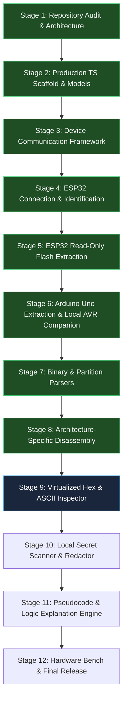

# Project Progress, 12-Stage Implementation Plan & Verification Matrix

## 1. 12-Stage Implementation Plan with Acceptance Gates

### Stage Breakdown & Strict Acceptance Gates

| Stage | Title & Scope | Status | Acceptance Gate Criteria |
| :---: | :--- | :---: | :--- |
| **Stage 1** | **Repository Audit, Official Docs Verification, & Architecture Specification** | **COMPLETE** | - Full audit of existing `v0.1.1` starter code with all bugs and deficiencies documented. - Confirmation of official API contracts (`esptool-js`, Web Serial, Optiboot, AVRDUDE). - `AGENTS.md` and 5 specification documents established. - Zero hardware modification. |
| **Stage 2** | **Production TypeScript Scaffold, Domain Models & Test Runner** | **COMPLETE** | - Vite 6 + React 19 + TypeScript configured at root with strict compiler checks. - Core domain models (`DeviceIdentity`, `MemoryRegion`, `ExtractionResult`) implemented. - Vitest / Node test runner operational with static AST assertion tests proving zero write/erase APIs exist in codebase. - `npm test` passed with 100% success. |
| **Stage 3** | **Device Communication Framework** | **COMPLETE** | - Typed device interfaces defined: `DeviceAdapter`, `DeviceConnection`, `DeviceIdentity`, `FlashInfo`, `MemoryReadRequest`, `MemoryReadProgress`, `MemoryReadResult`, `DeviceError`, `DisconnectResult`. - Lifecycle state machine implemented: `disconnected`, `requesting_permission`, `connecting`, `connected`, `identifying`, `reading`, `disconnecting`, `error`. - Browser Web Serial capability detection & permission/busy error handling. - `MockDeviceAdapter` with progressive reading and `AbortController` cancellation. - UI wired to consume typed connection state. - 26 automated unit tests passed. No extraction code; zero destructive commands. |
| **Stage 4** | **ESP32 Connection and Identification** | **COMPLETE** *(Software-Tested)* | - `Esp32Adapter` implemented using pinned `esptool-js 0.7.1` over Web Serial. - User-initiated serial port picker with permission denial & port busy handling. - Dynamic chip identification (detects classic ESP32, S2, S3, C-series, H-series, or Unknown/Unverified). - Dynamic SPI Flash capacity detection via `detectFlashSize()` and raw `readFlashId()`. - Conservative initial baud rate (115,200) with safe retry options. - Diagnostic log panel without exposing raw binary bytes or secrets. - Actionable manual BOOT/RESET button guidance on sync timeout. - Safe `hard_reset` on disconnect to restore board to normal boot. - 36 automated unit & safety tests passed. Zero Flash write or erase. |
| **Stage 5** | **ESP32 Read-Only Flash Extraction** | **COMPLETE** *(Software-Tested)* | - `Esp32FlashExtractor` implemented using official `readFlash()` API. - Step 1 user-approved 4 KiB test slice at `0x1000` with length and SHA-256 validation. - Step 2 bounded 64 KiB chunk streaming with exact offset ordering. - Shannon entropy and content readability classification (`readable`, `likely_encrypted`, `partially_readable`, `undetermined`). - Real-time progress updates with address ranges and transfer speed. - Non-blocking cancellation via `AbortSignal` with partial data preservation. - Error recovery preserving partial dumps (never silently truncated). - Byte-for-byte in-memory export verification. - Safe hardware reset to preserve running sensor application. - 51 automated unit & safety tests passed. Zero Flash write or erase. |
| **Stage 6** | **Arduino Uno Flash Extraction & Hardened Local AVR Companion Agent** | **COMPLETE** *(Software-Tested)* | - Python companion bound strictly to loopback `127.0.0.1:8765`. - Origin validation and ephemeral `X-MicroCode-Session` token enforcement. - Serial port enumeration and strict whitelist validation against command injection. - Subprocess argument arrays only; zero `shell=True`, zero write modes, zero chip erase (`-e`). - ATmega328P signature verification (`0x1E 0x95 0x0F`) and Mode 3 lock-bit detection without destructive bypass. - Intel HEX parser reconstituting 32 KiB memory image and distinguishing programmed bytes from unprogrammed `0xFF` padding. - Full browser `ArduinoUnoAdapter` with client-side SHA-256 verification and Intel HEX + binary export. - 14 Python companion tests + 8 TypeScript Uno adapter tests passed. |
| **Stage 7** | **Firmware Parsing and Memory Map** | **COMPLETE** *(Software-Tested)* | - Offline ESP image parser validating format v1 headers, segment load addresses, XOR checksums, and appended SHA-256. - Offline ESP-IDF partition table parser validating magic 0xAA50, entry records, 16-byte MD5 checksum records, partition overlaps, and out-of-bounds boundaries. - Offline Intel HEX parser verifying 2's complement checksums, address records, gap collation, and non-destructive binary conversion. - ATmega328P memory mapper with vector table parsing, application space, verified vs heuristic bootloader boundary qualifications (fuses), and isolated EEPROM region. - General binary analyzers: file signature detector, printable string extractor (ASCII/UTF-8 with byte offsets), and windowed Shannon entropy heuristic analyzer. - Unified `MemoryMapEngine` generating repeatable reports with strict rule: "Unknown data stays Unknown." - Interactive UI tabs (`Memory Map` and `Strings`) with offline file loader (.bin/.hex) distinguishing verified findings from heuristics. - 36 new parser unit tests passed (95 TS + 14 Python = 109 total). |
| **Stage 8** | **Architecture-Specific Disassembly** | **COMPLETE** *(Software-Tested)* | - Architecture disassembler interface (`ArchitectureDisassembler`) preventing monolithic generic disassembly. - Native pure-TS ATmega328P / 8-bit AVR disassembler engine: decodes 16-bit and 32-bit opcodes (`JMP`, `CALL`, `LDS`, `STS`, `RJMP`, `RCALL`, `IN`, `OUT`, `SBI`, `CBI`, branches, ALU, immediate), maps hardware I/O registers (`PORTB`, `DDRB`, `UDR0`, `ADMUX`), calculates relative branch targets, preserves addresses, and flags undecodable/erased (`0xFFFF`) words without crashing. - ESP32 / Xtensa LX6 disassembler adapter: toolchain verification (`xtensa-esp32-elf-objdump`), explicit load-address handling (`0x40080000` IRAM vs `0x400D0000` Flash MMU), strict `unsupported` status when toolchain is missing with clear CLI guidance and limitation explanations. - Unsupported architecture adapter for `xtensa-lx7` and `riscv32` explaining missing toolchains. - Central `DisassemblerRegistry` routing microcontrollers to their verified architecture backends. - Formatted `.asm` listing exporter with provenance header, confidence level, load-address basis, and limitation disclaimers. - Interactive UI `AssemblyViewer` with address/hex/mnemonic table, search & filtering, jump target highlighting, copy, and file export. - 16 new automated unit tests passed (111 TS + 14 Python = 125 total). |
| **Analysis Layer** | **Traceable Approximate Pseudocode & Control-Flow Reconstruction** | **COMPLETE** *(Software-Tested)* | - Control-Flow Graph (CFG) and basic block partitioner identifying block leaders and branch edges (`conditional_true`, `conditional_false`, `unconditional`, `call`, `return`). - Probable function boundary detector with entry candidate scoring (reset vector, call sites, post-return sequences) and strictly synthetic naming (`func_00001234`). - Static cross-reference indexer resolving calls, jumps, and memory access addresses. - Loop pattern detector identifying infinite loops (`rjmp .-2`), counted loops with counter variables, and while/do-while structures. - Microcontroller peripheral hardware access inferrer strictly separating confirmed assembly register facts from high-level inferred meanings (e.g., `PORTB` LED pin 13 write, `UDR0` serial send). - Approximate pseudocode generator enforcing non-negotiable standards: labeled "approximate reconstruction" or "inferred pseudocode", linked back to assembly addresses `[0x...]`, synthetic variables (`var_r16`), preserved undecodable `.word` unknowns, zero claims of original `.ino` recovery. - Optional LLM explainer: strictly opt-in (disabled by default), local-only mode with zero network calls, payload text disclosure (no binary upload), automated local credential redaction, model outputs tagged as unverified hypotheses. - Interactive UI `PseudocodeView` with function selector, assembly traceability table, hardware peripherals table, and CFG summary. - 13 new automated unit tests passed (124 TS + 14 Python = 138 total). |
| **Stage 9** | **Virtualized Hex & ASCII Inspection Engine** | Queued (Next) | - Viewport-virtualized hex/ASCII table supporting multi-megabyte dumps without DOM lag. - Address offset navigation and printable ASCII/UTF-8 extraction. - Partition boundary highlighting. - Verified download controls for `.bin` and `.hex` formats with byte-count and checksum verification. |
| **Stage 10** | **Local Secret Scanner & Redactor** | Queued | - Client-side regex engine detecting Wi-Fi SSIDs/PSKs, cloud API keys, and private keys. - Automatic masking of probable secrets in UI previews and audit reports. - Explicit user confirmation toggle to reveal underlying raw bytes. |
| **Stage 11** | **Approximate Pseudocode & Control-Flow Reconstruction** | Merged (Above) | - Implemented as dedicated Analysis Layer on top of Stage 8 verified disassembly. |
| **Stage 12** | **End-to-End Hardware Validation Bench & Final Release** | Queued | - Physical hardware test on user's ESP32 DevKit V1: extraction, SHA-256 verification, and proof of preserved sensor application. - Physical hardware test on Arduino Uno R3: signature verification, flash dump, and sketch preservation. - Final audit report generated; all documentation updated with authentic hardware test logs. |

---

## 2. Automated Test Suite Audit Log

| Test Suite | Scope | Status | Passed / Total |
| :--- | :--- | :---: | :---: |
| **CFG & Basic Block Builder Tests** | Basic block partitioning, edge types, conditional branch targets, loop cycle detection | **PASS** | 3 / 3 |
| **Function Boundary Detector Tests** | Entry detection (reset vector, call targets, post-return), synthetic naming, confidence scores | **PASS** | 2 / 2 |
| **Loop Pattern Detector Tests** | Infinite loop detection, counted loops with iteration variables, conditional loops | **PASS** | 2 / 2 |
| **Peripheral Access Inferrer Tests** | Hardware I/O register detection (PORTB, PINB, UDR0), fact vs inference separation, LED pin 13 | **PASS** | 1 / 1 |
| **Pseudocode Generator Tests** | "approximate reconstruction" label, assembly address links, synthetic variables, preserved unknowns | **PASS** | 2 / 2 |
| **Optional LLM Explainer Tests** | Opt-in requirement, credential redaction, local-only template mode, hypothesis notice | **PASS** | 3 / 3 |
| **AVR 8-bit Disassembler Tests** | Opcodes (NOP, RET, JMP, CALL, LDS, STS, RJMP, RCALL, LDI, OUT, IN, branches), I/O register names, undecodables, erased padding | **PASS** | 7 / 7 |
| **ESP32 / Xtensa LX6 Disassembler Tests** | Unsupported state without toolchain, command line guidance, mock runner parsing, base address handling | **PASS** | 3 / 3 |
| **Disassembler Registry Tests** | Architecture adapter routing (avr8, xtensa-lx6, xtensa-lx7, riscv32), unsupported fallback, list models | **PASS** | 4 / 4 |
| **Assembly Exporter Tests** | Assembly listing formatting, provenance metadata, limitations disclaimer, jump markers | **PASS** | 2 / 2 |
| **ESP Image Parser Tests** | Header format v1, segments, entry point, chipId mapping, checksums, SHA-256 | **PASS** | 7 / 7 |
| **ESP Partition Table Parser Tests** | Magic 0xAA50, entry decoding, MD5 checksum validation, overlaps, out-of-bounds | **PASS** | 6 / 6 |
| **Intel HEX Parser Tests** | 2's complement checksums, segment addressing, gap collation, binary reconstitution | **PASS** | 6 / 6 |
| **ATmega328P Memory Mapper Tests** | Vector table, app code, padding, bootloader boundary (heuristic vs verified), EEPROM | **PASS** | 4 / 4 |
| **General Parsers Tests** | Multi-format signatures, string extraction (ASCII/UTF-8), Shannon entropy heuristic | **PASS** | 9 / 9 |
| **Unified Memory Map Engine Tests** | Repeatable report, ESP32 full dump, Uno HEX, unknown data preservation, malformed data | **PASS** | 4 / 4 |
| **Arduino Uno Companion Adapter Tests** | Companion health, ports, 32 KiB extraction, SHA-256 integrity, lock bits, Optiboot | **PASS** | 8 / 8 |
| **Python Companion Security & AVRDUDE Tests** | Origin check, session tokens, port whitelist, HEX parsing & checksums, static safety | **PASS** | 14 / 14 |
| **ESP32 Flash Extraction Tests** | Chunk boundaries, test slice, partial dumps, cancellation, classification | **PASS** | 15 / 15 |
| **ESP32 Adapter Tests** | Architecture mapping, loader lifecycle, timeout guidance, disconnect reset | **PASS** | 10 / 10 |
| **Device Framework Tests** | State machine, mock adapter, errors, cancellation | **PASS** | 13 / 13 |
| **Safety Assertions** | Zero write/erase APIs in codebase | **PASS** | 5 / 5 |
| **Address Arithmetic** | Hex formatting, byte sizes, chunk slices | **PASS** | 5 / 5 |
| **Cryptographic Hashing** | SHA-256 test vectors & determinism, pure-TS MD5 | **PASS** | 3 / 3 |
| **Total Test Count** | All automated tests | **PASS** | **138 / 138 (100%)** |
