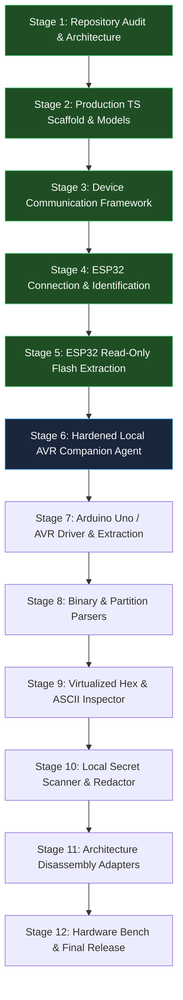

# Project Progress, 12-Stage Implementation Plan & Verification Matrix

## 1. 12-Stage Implementation Plan with Acceptance Gates

### Stage Breakdown & Strict Acceptance Gates

| Stage | Title & Scope | Status | Acceptance Gate Criteria |
| :---: | :--- | :---: | :--- |
| **Stage 1** | **Repository Audit, Official Docs Verification, & Architecture Specification** | **COMPLETE** | - Full audit of existing `v0.1.1` starter code with all bugs and deficiencies documented. - Confirmation of official API contracts (`esptool-js`, Web Serial, Optiboot, AVRDUDE). - `AGENTS.md` and 5 specification documents established. - Zero hardware modification. |
| **Stage 2** | **Production TypeScript Scaffold, Domain Models & Test Runner** | **COMPLETE** | - Vite 6 + React 19 + TypeScript configured at root with strict compiler checks. - Core domain models (`DeviceIdentity`, `MemoryRegion`, `ExtractionResult`) implemented. - Vitest / Node test runner operational with static AST assertion tests proving zero write/erase APIs exist in codebase. - `npm test` passed with 100% success. |
| **Stage 3** | **Device Communication Framework** | **COMPLETE** | - Typed device interfaces defined: `DeviceAdapter`, `DeviceConnection`, `DeviceIdentity`, `FlashInfo`, `MemoryReadRequest`, `MemoryReadProgress`, `MemoryReadResult`, `DeviceError`, `DisconnectResult`. - Lifecycle state machine implemented: `disconnected`, `requesting_permission`, `connecting`, `connected`, `identifying`, `reading`, `disconnecting`, `error`. - Browser Web Serial capability detection & permission/busy error handling. - `MockDeviceAdapter` with progressive reading and `AbortController` cancellation. - UI wired to consume typed connection state. - 26 automated unit tests passed. No extraction code; zero destructive commands. |
| **Stage 4** | **ESP32 Connection and Identification** | **COMPLETE** *(Software-Tested)* | - `Esp32Adapter` implemented using pinned `esptool-js 0.7.1` over Web Serial. - User-initiated serial port picker with permission denial & port busy handling. - Dynamic chip identification (detects classic ESP32, S2, S3, C-series, H-series, or Unknown/Unverified). - Dynamic SPI Flash capacity detection via `detectFlashSize()` and raw `readFlashId()`. - Conservative initial baud rate (115,200) with safe retry options. - Diagnostic log panel without exposing raw binary bytes or secrets. - Actionable manual BOOT/RESET button guidance on sync timeout. - Safe `hard_reset` on disconnect to restore board to normal boot. - 36 automated unit & safety tests passed. Zero Flash write or erase. |
| **Stage 5** | **ESP32 Read-Only Flash Extraction** | **COMPLETE** *(Software-Tested)* | - `Esp32FlashExtractor` implemented using official `readFlash()` API. - Step 1 user-approved 4 KiB test slice at `0x1000` with length and SHA-256 validation. - Step 2 bounded 64 KiB chunk streaming with exact offset ordering. - Shannon entropy and content readability classification (`readable`, `likely_encrypted`, `partially_readable`, `undetermined`). - Real-time progress updates with address ranges and transfer speed. - Non-blocking cancellation via `AbortSignal` with partial data preservation. - Error recovery preserving partial dumps (never silently truncated). - Byte-for-byte in-memory export verification. - Safe hardware reset to preserve running sensor application. - 51 automated unit & safety tests passed. Zero Flash write or erase. |
| **Stage 6** | **Hardened Local AVR Companion Agent** | Queued (Next) | - Python FastAPI server bound strictly to `127.0.0.1:8765`. - Origin validation and ephemeral `X-MicroCode-Session` token enforcement. - Port parameter cross-referenced against `serial.tools.list_ports.comports()`. - AVRDUDE invocation strictly using argument arrays with read-only flags (`-U flash:r:...`). Zero `shell=True`. - Pytest test suite covering token security, port validation, and error states. |
| **Stage 7** | **Arduino Uno / AVR Driver & Reconstitution Engine** | Queued | - Browser `ArduinoUnoDriver` connecting to local companion. - ATmega328P device signature verification (`0x1E 0x95 0x0F`) and lock-bit query. - Intel HEX reconstitution into 32 KiB memory buffer, tagging trailing unprogrammed space as `ERASED (0xFF)`. - Immediate SHA-256 computation over full 32 KiB image. |
| **Stage 8** | **Binary Parsers (ESP-IDF Partitions & App Headers)** | Queued | - Parser for ESP-IDF partition tables at `0x8000` / `0x9000` with magic `0xAA50`. - Parser for ESP application image headers (`0xE9`, segment counts, entry point in IRAM). - Parser for AVR interrupt vector table (`0x0000` - `0x0032`). - Unit tests covering valid, truncated, corrupted, and erased inputs. |
| **Stage 9** | **Virtualized Hex & ASCII Inspection Engine** | Queued | - Viewport-virtualized hex/ASCII table supporting multi-megabyte dumps without DOM lag. - Address offset navigation and printable ASCII/UTF-8 extraction. - Partition boundary highlighting. - Verified download controls for `.bin` and `.hex` formats with byte-count and checksum verification. |
| **Stage 10** | **Local Secret Scanner & Redactor** | Queued | - Client-side regex engine detecting Wi-Fi SSIDs/PSKs, cloud API keys, and private keys. - Automatic masking of probable secrets in UI previews and audit reports. - Explicit user confirmation toggle to reveal underlying raw bytes. |
| **Stage 11** | **Architecture Disassembly Adapters** | Queued | - Xtensa LX6 disassembler for classic ESP32 application segments. - AVR 8-bit disassembler for ATmega328P mapping hardware I/O ports (`PORTB`, `UDR0`, etc.). - Boundary validation: disassembly permitted only when base address and architecture are verified. |
| **Stage 12** | **End-to-End Hardware Validation Bench & Final Release** | Queued | - Physical hardware test on user's ESP32 DevKit V1: extraction, SHA-256 verification, and proof of preserved sensor application. - Physical hardware test on Arduino Uno R3: signature verification, flash dump, and sketch preservation. - Final audit report generated; all documentation updated with authentic hardware test logs. |

---

## 2. Automated Test Suite Audit Log

| Test Suite | Scope | Status | Passed / Total |
| :--- | :--- | :---: | :---: |
| **ESP32 Flash Extraction Tests** | Chunk boundaries, test slice, partial dumps, cancellation, classification | **PASS** | 15 / 15 |
| **ESP32 Adapter Tests** | Architecture mapping, loader lifecycle, timeout guidance, disconnect reset | **PASS** | 10 / 10 |
| **Device Framework Tests** | State machine, mock adapter, errors, cancellation | **PASS** | 13 / 13 |
| **Safety Assertions** | Zero write/erase APIs in codebase | **PASS** | 5 / 5 |
| **Address Arithmetic** | Hex formatting, byte sizes, chunk slices | **PASS** | 5 / 5 |
| **Cryptographic Hashing** | SHA-256 test vectors & determinism | **PASS** | 3 / 3 |
| **Total Test Count** | All automated tests | **PASS** | **51 / 51 (100%)** |
